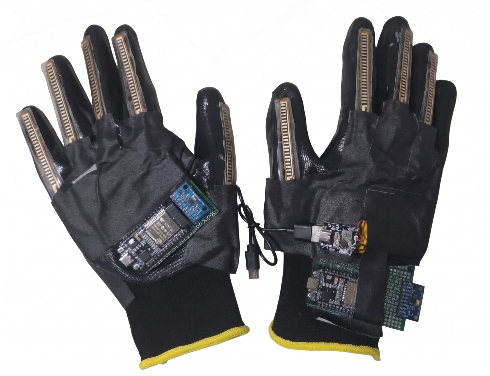

# Guants traductors de Llengua de Signes Catalana (LSC)
 
Dos guants amb sensors que reconeixen signes de la Llengua de Signes Catalana i els converteixen en text i veu en català. La intel·ligència artificial s'executa dins del mateix guant (un microcontrolador ESP32), sense internet.
 
Aquest repositori acompanya el treball de recerca **«Disseny i prototipatge d’un dispositiu
per a la traducció de la
Llengua de Signes Catalana
»**, de Carlos Andrés Angulo i Enzo Ariza, Institut Frederic Mompou, curs 2026-27. Al treball hi ha l'explicació completa, amb les fonts, aquí hi ha el codi i les instruccions per fer-lo servir.


 
## Com funciona
 
```
Guant esquerre ──USB──► Ordinador ──USB──► Guant dret ──USB──► Ordinador
5 sensors de flexió     reenvia les        ajunta les dues     mostra la frase
+ IMU                   dades              mans, executa el    i la diu en veu alta
                                           model i decideix
                                           quin signe s'ha fet
```
 
- Cada guant té **5 sensors de flexió** (un per dit) i una **IMU** (acceleròmetre i giroscopi) al dors de la mà.
- Els guants llegeixen els sensors 100 vegades per segon i envien 50 trames per segon.
- El **guant dret** calcula 34 valors a partir de les dues mans i, cada 200 ms, la xarxa neuronal analitza els darrers 2 segons.
- Quan reconeix un signe, l'**aplicació de l'ordinador** l'afegeix a la frase, conjuga els verbs (JO + ANAR → «jo vaig»; JO ESTIMAR TU → «jo t'estimo») i la diu en veu alta.
## Què hi ha a cada carpeta
 
| Carpeta | Què conté |
|---|---|
| `firmware/LSC_Left/` | Programa del guant esquerre: llegeix els sensors i els envia a l'ordinador. |
| `firmware/LSC_Right/` | Programa del guant dret: sensors, càlcul de les dades d'entrada, model d'intel·ligència artificial i lògica de decisió. |
| `pc/` | Aplicació de l'ordinador (calibrar, gravar, provar i traduir) i el programa que prepara les dades per a Edge Impulse. |
| `docs/` | Fotografies i vídeos. |
 
El model entrenat **no és en aquesta llista**: és a l'apartat **Releases** (versions) del repositori, com a biblioteca d'Arduino (`.zip`).
 
## Dades
 
Totes les dades amb què es va entrenar i provar el model (els conjunts d'entrenament i de test) són a Hugging Face:
**https://huggingface.co/datasets/Charles-Andrew/TR_LSC/tree/main**
 
Són finestres de 2 segons amb els 34 valors de les dues mans, 50 vegades per segon, en el format que fa servir Edge Impulse. El nom de cada fitxer comença pel signe que conté (per exemple, `hola.w03599.csv`).
 
## Què necessites
 
**Material** (uns 80 € els dos guants):
 
| Component | Quantitat |
|---|---|
| Sensor de flexió | 10 |
| Placa ESP32 | 2 |
| IMU MPU-6050 | 2 |
| Resistència de 10 kΩ | 10 |
| Guants, cables i placa | 2 |
 
Les connexions són a l'esquema del treball i als comentaris de `firmware/LSC_Left/LSC_Left.ino` i `firmware/LSC_Right/LSC_Right.ino`.
 
**Programes:**
- [Arduino IDE](https://www.arduino.cc/en/software) amb les plaques ESP32 (Espressif).
- Python 3 i les biblioteques de `pc/requirements.txt`.

## Model
El model reconeix 23 signes i una classe de repòs:
 
- **Paraules:** HOLA, BON DIA, JO, TU, GRÀCIES, SI US PLAU, AIGUA, AJUDAR, ANAR, ESTIMAR, FER, VOLER, SÍ, NO, QUÈ, ON, QUAN, QUI
- **Lletres de l'alfabet dactilològic:** A, C, I, L, S
Els signes es van aprendre del canal de YouTube [Vocabulari bàsic en LSC](https://www.youtube.com/@LSC_Vocabulari).
 
